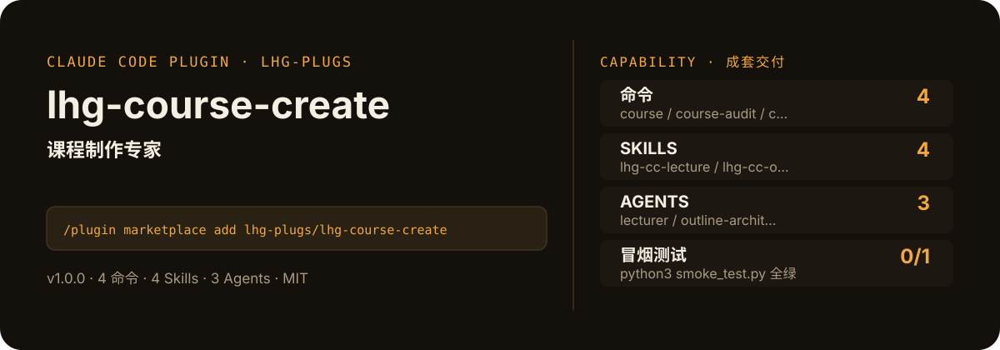

<!-- About 简介（推送后填写到仓库 About 栏）：
课程制作专家：主题→四段式课程大纲→口语化逐节讲义→三档难度配套习题→试听课引流脚本，一门知识付费课从 0 到可交付，大纲-讲义-习题一致性自动审计。 ｜ 一键安装：/plugin marketplace add lhg-plugs/lhg-course-create
-->
<!-- topics（推送后打）：claude-code, claude-plugin, agent-skills, course-creation, curriculum, online-course, quiz, lecture -->

<p align="center">
  
</p>

> **一句话介绍**：课程制作专家：主题→四段式课程大纲→口语化逐节讲义→三档难度配套习题→试听课引流脚本，一门知识付费课从 0 到可交付，大纲-讲义-习题一致性自动审计。

**一键安装**：在 Claude Code 里运行

```bash
/plugin marketplace add lhg-plugs/lhg-course-create
/plugin install lhg-course-create@lhg-plugs
```

## 它能帮你做出什么

- **冒烟测试**：`python3 smoke_test.py` 本次实测通过 0/1 项（见仓库自带测试输出）。

## 它是什么

`lhg-course-create` 是一个 Claude Code 插件（plugin 为主、skill 为辅）：

- **4 个命令**（小白入口）：`course` 完整课程制作、`course-audit` 课程一致性自检、`course-outline` 课程大纲单发、`course-quiz` 配套习题单发
- **4 个平台中立 skill**（方法论，可移植到豆包/Workbuddy 等 agent 平台）：lhg-cc-lecture, lhg-cc-outline, lhg-cc-quiz, lhg-cc-trial
- **3 个专家 agent**：lecturer, outline-architect, quiz-checker
- **1 个 hooks**（`hooks/`：validate_course_before_deliver.py），关键操作前自动把关

## 为什么是它

不是一个 prompt，而是一套互相兜底的机制：

1. **硬门，不是提醒**：hooks 在关键操作前自动拦截或警告（见 `hooks/`），而不是只在文档里写一句"请注意"。
2. **方法论沉淀在 skill 里**：流程、检查清单、口径都写在 `skills/` 的方法论里，命令只是入口；换个 agent 平台也能复用同一套做法。
3. **可验，不是可信**：`fixtures/` 备有坏/好对照用例，`smoke_test.py` 一键验证，规则有没有生效、自己跑一遍就知道。

## 快速上手

```bash
# 1. 安装（Claude Code 里运行）
/plugin marketplace add lhg-plugs/lhg-course-create
/plugin install lhg-course-create@lhg-plugs

# 2. 完整课程制作：主题→课程大纲→逐节讲义→配套习题→试听课引流脚本，一门知识付费课
/lhg-course-create:course 小白做短视频 零基础新手
```

| 命令 | 作用 | 示例 |
|---|---|---|
| `/lhg-course-create:course` | 完整课程制作：主题→课程大纲→逐节讲义→配套习题→试听课引流脚本，一门知识付费课从 0 到可交付。 | `/lhg-course-create:course 小白做短视频 零基础新手` |
| `/lhg-course-create:course-audit` | 课程一致性自检：对交付目录跑 20 条确定性规则（大纲-讲义-习题映射、习题覆盖、四段式、口语化）… | `/lhg-course-create:course-audit ./delivery/ --strict` |
| `/lhg-course-create:course-outline` | 课程大纲单发：主题+目标学员→大纲三问→四段式大纲（3–12 章）→评审清单→用户拍板。 | `/lhg-course-create:course-outline 剪映入门 宝妈` |
| `/lhg-course-create:course-quiz` | 配套习题单发：讲义/大纲→每章 3 道起步→记忆/理解/应用三档→答案解析→一致性检查。 | `/lhg-course-create:course-quiz 第1章讲义` |

## 什么时候用 / 什么时候不用（FAQ）

**什么时候用：**

- 你需要完整课程制作时 → 用 `/lhg-course-create:course`
- 你需要课程一致性自检时 → 用 `/lhg-course-create:course-audit`
- 你需要课程大纲单发时 → 用 `/lhg-course-create:course-outline`

**什么时候不用：**

- 你只需要其中一个零散能力时 → 本插件是成套流程，单点需求用更轻量的 skill 更合适
- 你希望 AI 完全自由发挥、不接受任何自查与硬门时 → 它的规则审计与 hooks 会介入（可关，但那就别装它）
- 你的场景不在上面命令表覆盖范围内时 → 先看命令表，没有对应命令就别硬套

## 目录结构

```
lhg-course-create/
├── smoke_test.py          # 一键冒烟测试
├── ATTRIBUTION.md         # 灵感来源与许可声明
├── LICENSE                # MIT
├── README.md              # 本文件
├── .claude-plugin/
├── agents/
├── commands/
├── fixtures/
├── hooks/
├── scripts/
├── skills/
```

## 自检与反馈

本插件自带质检：每次使用后可跑 `python3 smoke_test.py` 一键验证。

发现 bug 或有改进建议，以 `[QC] <一句话问题>` 为标题提交到 https://github.com/lhg-plugs/lhg-course-create/issues，正文写清"复现步骤 → 实际表现 → 期望表现"。

同门插件见 [lhg-plugs](https://github.com/lhg-plugs)，86 个插件的完整矩阵在 [marketplace](https://github.com/lhg-plugs/marketplace) 维护。

## 出品：刘洪光

本插件由真人出镜 IP「刘洪光」（安徽合肥）出品，归属 [lhg-skills](https://github.com/lhg-skills)。

- GitHub 主页：https://github.com/lhg-skills —— 全部 skill 开源在此，欢迎 star
- 抖音：搜「刘老师讲AI实战」
- 微信：lhgsmsw
